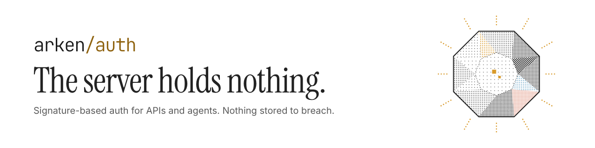

<!-- Save as .github/profile/README.md in a public repo named ".github" in the org.
     Put the two banner PNGs in that same repo at profile/assets/. -->

  <picture>
    <source media="(prefers-color-scheme: dark)" srcset="./assets/gh-org-banner-dark.png">
    
  </picture>

**Arken gives AI agents a cryptographic identity — no API keys, no passwords, nothing for a server to store or breach.** An agent signs a one-time nonce with a key it owns, the server verifies the signature in Rust, and the connection is authenticated. That's the whole protocol.

Each agent gets a [`did:key`](https://w3c-ccg.github.io/did-method-key/) — a self-describing identifier derived from its key pair. Same key, same DID, across every server running Arken. One identity, every tool.

### Why it matters for agents

| Without Arken | With Arken |
|---|---|
| API keys per service, rotated manually | One key pair, one DID — works everywhere |
| Secrets in `.env` files, in CI, in logs | Private key never leaves the agent |
| Server stores credentials worth stealing | Server stores nothing — nonces expire in 60s |
| Auth code duplicated in every agent | Drop-in `fetch` wrapper handles it transparently |

### Projects

| Repo | What it is |
|---|---|
| [arken-auth](https://github.com/ArkenForge/arken-protocol/tree/main/packages/arken-auth) | Express middleware. Rust crypto core, `did:key` identity. |
| [arken-client](https://github.com/ArkenForge/arken-protocol/tree/main/packages/arken-client) | Drop-in `fetch` for agents. Handles the challenge flow automatically. |
| [arken-auth (Python)](https://github.com/ArkenForge/arken-protocol/tree/main/packages/arken-auth-py) | FastAPI dependency. Same protocol, same DID scheme. |
| [arken-protocol](https://github.com/ArkenForge/arken-protocol) | Spec, reference implementations, examples, MCP server. |

### Get involved

- **Try it:** `npm install arken-client` — agents authenticate in three lines
- **Protect an MCP server:** see the [MCP Quickstart](https://github.com/ArkenForge/arken-docs/blob/main/arken-auth/mcp-quickstart.md)
- **Break it:** see `SECURITY.md` — valid finds are credited
- **Shape 1.0:** we're looking for a few agent teams to try it on a real API. [Apply here](https://tally.so/r/kbbjWR).
- **Follow releases:** Watch → Custom → Releases on the repo
